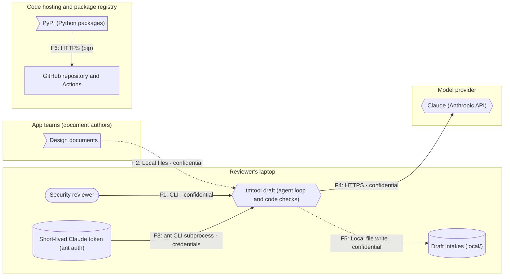

# Threat Model: tmtool draft (agent-assisted intake drafting)

| | |
|---|---|
| **Generated** | 2026-11-25 |
| **Owner** | Jay Holland |
| **Stage** | build |
| **Criticality** | High |
| **Users** | employees |

A security reviewer runs tmtool on their laptop. `tmtool draft` sends cleaned, redacted design documents to Claude, which proposes an intake through a small set of tools. Code checks every tool call and writes the draft. A person reviews it before `tmtool analyze` scores it.

## Executive summary

**Overall residual risk: 🟠 High** (highest-rated threat that is not fully mitigated)

| Rating | Open / partially mitigated | Mitigated |
|---|---|---|
| 🔴 Critical | 0 | 0 |
| 🟠 High | 17 | 0 |
| 🟡 Medium | 6 | 0 |
| 🟢 Low | 0 | 7 |

**Top risks to address:**

1. **Direct prompt injection and jailbreaks** on *Claude (Anthropic API)* (🟠 High, open). Add: `guardrails`, `prompt_injection_filter`
1. **Sensitive information disclosure through the model** on *Claude (Anthropic API)* (🟠 High, open). Add: `pii_filter`, `dlp`
1. **Excessive agency** on *Claude (Anthropic API)* (🟠 High, open). Add: `least_privilege_tools`, `human_approval`
1. **AI activity not logged for investigation** on *tmtool draft (agent loop and code checks)* (🟠 High, open). Add: `invocation_logging`
1. **Agent can be tricked into exfiltrating data ("lethal trifecta")** on *Claude (Anthropic API)* (🟠 High, open). Add: one of: `egress_control`, `human_approval`

⚠️ The intake left **3 open questions** (see *Questions for the app team*). Answering them may add or change findings.

## Scope

| Component | Type | Zone | Internet-facing | Data | Controls |
|---|---|---|---|---|---|
| **Security reviewer** (`reviewer`) | user | laptop | No | — | — |
| **Design documents** (`design-docs`) | external_system | app-teams | No | confidential | — |
| **tmtool draft (agent loop and code checks)** (`draft-agent`) | ai_agent | laptop | No | confidential | least_privilege_tools, tool_allowlist, human_approval, output_validation, input_validation, prompt_injection_filter, data_minimization, token_quota |
| **Claude (Anthropic API)** (`claude`) | llm | vendor | No | confidential | no_secrets_in_prompts, human_review |
| **Short-lived Claude token (ant auth)** (`credential`) | secrets_store | laptop | No | credentials | secrets_manager |
| **Draft intakes (local/)** (`drafts`) | object_storage | laptop | No | confidential | public_access_block, restricted_log_access |
| **GitHub repository and Actions** (`repo-ci`) | ci_cd | supply-chain | No | — | secrets_scanning, vuln_scanning, iac_scanning |
| **PyPI (Python packages)** (`pypi`) | external_system | supply-chain | No | — | — |

**Application-wide controls** (apply to every component): `no_secrets_in_prompts`, `human_review`

## Data flow diagram

Boxes are trust zones. Dotted arrows are unencrypted flows.

### Trust boundary crossings

Threats concentrate where data crosses between zones.

| Flow | From → To | Zones | Protocol | Data | Encrypted | Authenticated |
|---|---|---|---|---|---|---|
| F2 | Design documents → tmtool draft (agent loop and code checks) | app-teams → laptop | Local files | confidential | **No** | **No** |
| F4 | tmtool draft (agent loop and code checks) → Claude (Anthropic API) | laptop → vendor | HTTPS | confidential | Yes | Yes |

## Threat register

Sorted by risk score (likelihood × impact, 1–25).

| ID | Risk | Threat | Target | STRIDE | L | I | Score | Status | Missing controls |
|---|---|---|---|---|---|---|---|---|---|
| T-001 | 🟠 High | Direct prompt injection and jailbreaks | Claude (Anthropic API) | TE | 4 | 4 | **16** | Open | guardrails, prompt_injection_filter |
| T-002 | 🟠 High | Sensitive information disclosure through the model | Claude (Anthropic API) | I | 3 | 5 | **15** | Open | pii_filter, dlp |
| T-003 | 🟠 High | Excessive agency | Claude (Anthropic API) | E | 3 | 5 | **15** | Open | least_privilege_tools, human_approval |
| T-004 | 🟠 High | AI activity not logged for investigation | tmtool draft (agent loop and code checks) | R | 3 | 5 | **15** | Open | invocation_logging |
| T-005 | 🟠 High | Agent can be tricked into exfiltrating data ("lethal trifecta") | Claude (Anthropic API) | I | 3 | 5 | **15** | Open | one of: egress_control, human_approval |
| T-006 | 🟠 High | Pipeline compromise or unauthorized deployment | GitHub repository and Actions | TE | 3 | 5 | **15** | Open | branch_protection, deploy_approvals, least_privilege_iam |
| T-007 | 🟠 High | Unknown sensitive data in storage | Draft intakes (local/) | I | 3 | 5 | **15** | Open | data_classification_scanning |
| T-008 | 🟠 High | Unencrypted data flow | F2: Design documents → tmtool draft (agent loop and code checks) | IT | 3 | 5 | **15** | Open | one of: tls, mtls |
| T-009 | 🟠 High | Unencrypted data flow | F5: tmtool draft (agent loop and code checks) → Draft intakes (local/) | IT | 3 | 5 | **15** | Open | one of: tls, mtls |
| T-010 | 🟠 High | Unauthenticated flow across a trust boundary | F2: Design documents → tmtool draft (agent loop and code checks) | S | 3 | 5 | **15** | Open | one of: mtls, service_auth |
| T-011 | 🟠 High | Long-lived static credentials in workloads | tmtool draft (agent loop and code checks) | SI | 3 | 5 | **15** | Open | workload_identity, secrets_manager |
| T-012 | 🟠 High | Over-privileged workload identity | tmtool draft (agent loop and code checks) | E | 3 | 5 | **15** | Open | least_privilege_iam |
| T-013 | 🟠 High | Insufficient audit logging | tmtool draft (agent-assisted intake drafting) | R | 3 | 5 | **15** | Open | audit_logging, logging_siem |
| T-014 | 🟠 High | Data store reachable from public networks | Claude (Anthropic API) | I | 3 | 5 | **15** | Open | one of: private_endpoint, public_access_block |
| T-015 | 🟠 High | Data store reachable from public networks | Short-lived Claude token (ant auth) | I | 3 | 5 | **15** | Open | one of: private_endpoint, public_access_block |
| T-016 | 🟠 High | Model output trusted by downstream systems | Claude (Anthropic API) | TE | 3 | 4 | **12** | Open | output_validation |
| T-017 | 🟠 High | AI activity not logged for investigation | Claude (Anthropic API) | R | 3 | 4 | **12** | Open | invocation_logging |
| T-018 | 🟡 Medium | Unapproved or compromised models | Claude (Anthropic API) | T | 2 | 5 | **10** | Open | model_allowlist |
| T-019 | 🟡 Medium | Inaccurate output used for decisions | Claude (Anthropic API) | T | 2 | 5 | **10** | Partially mitigated | grounding_checks |
| T-020 | 🟡 Medium | Data destruction or ransomware | Draft intakes (local/) | TD | 2 | 5 | **10** | Open | backups, object_lock |
| T-021 | 🟡 Medium | Uncontrolled outbound traffic enables data exfiltration | tmtool draft (agent loop and code checks) | I | 2 | 5 | **10** | Open | egress_control |
| T-022 | 🟡 Medium | Vendor or SaaS handling sensitive data | Design documents | I | 2 | 5 | **10** | Open | vendor_risk_assessment |
| T-023 | 🟡 Medium | Unbounded consumption and cost abuse | Claude (Anthropic API) | D | 3 | 3 | **9** | Open | token_quota, rate_limiting |
| T-024 | 🟢 Low | Excessive agency | tmtool draft (agent loop and code checks) | E | 1 | 5 | **5** | Mitigated | — |
| T-025 | 🟢 Low | Untrusted tools or MCP servers connected to the agent | tmtool draft (agent loop and code checks) | TE | 1 | 5 | **5** | Mitigated | — |
| T-026 | 🟢 Low | Agent can be tricked into exfiltrating data ("lethal trifecta") | tmtool draft (agent loop and code checks) | I | 1 | 5 | **5** | Mitigated | — |
| T-027 | 🟢 Low | Data store reachable from public networks | Draft intakes (local/) | I | 1 | 5 | **5** | Mitigated | — |
| T-028 | 🟢 Low | Secrets committed to code or configuration | GitHub repository and Actions | I | 1 | 5 | **5** | Mitigated | — |
| T-029 | 🟢 Low | Infrastructure misconfiguration reaches production | GitHub repository and Actions | TI | 1 | 4 | **4** | Mitigated | — |
| T-030 | 🟢 Low | System prompt leakage | Claude (Anthropic API) | I | 1 | 3 | **3** | Mitigated | — |

## Required before go-live

Critical and High threats that are not fully mitigated. Fix these, or document a risk acceptance with a named owner and an expiry date.

| ID | Threat | Target | Controls to add |
|---|---|---|---|
| T-001 | Direct prompt injection and jailbreaks | Claude (Anthropic API) | guardrails, prompt_injection_filter |
| T-002 | Sensitive information disclosure through the model | Claude (Anthropic API) | pii_filter, dlp |
| T-003 | Excessive agency | Claude (Anthropic API) | least_privilege_tools, human_approval |
| T-004 | AI activity not logged for investigation | tmtool draft (agent loop and code checks) | invocation_logging |
| T-005 | Agent can be tricked into exfiltrating data ("lethal trifecta") | Claude (Anthropic API) | one of: egress_control, human_approval |
| T-006 | Pipeline compromise or unauthorized deployment | GitHub repository and Actions | branch_protection, deploy_approvals, least_privilege_iam |
| T-007 | Unknown sensitive data in storage | Draft intakes (local/) | data_classification_scanning |
| T-008 | Unencrypted data flow | F2: Design documents → tmtool draft (agent loop and code checks) | one of: tls, mtls |
| T-009 | Unencrypted data flow | F5: tmtool draft (agent loop and code checks) → Draft intakes (local/) | one of: tls, mtls |
| T-010 | Unauthenticated flow across a trust boundary | F2: Design documents → tmtool draft (agent loop and code checks) | one of: mtls, service_auth |
| T-011 | Long-lived static credentials in workloads | tmtool draft (agent loop and code checks) | workload_identity, secrets_manager |
| T-012 | Over-privileged workload identity | tmtool draft (agent loop and code checks) | least_privilege_iam |
| T-013 | Insufficient audit logging | tmtool draft (agent-assisted intake drafting) | audit_logging, logging_siem |
| T-014 | Data store reachable from public networks | Claude (Anthropic API) | one of: private_endpoint, public_access_block |
| T-015 | Data store reachable from public networks | Short-lived Claude token (ant auth) | one of: private_endpoint, public_access_block |
| T-016 | Model output trusted by downstream systems | Claude (Anthropic API) | output_validation |
| T-017 | AI activity not logged for investigation | Claude (Anthropic API) | invocation_logging |

## Threat details

### T-001 · Direct prompt injection and jailbreaks

**🟠 High** · score 16 (L4 × I4) · Open · rule `AI-01`

- **Target:** Claude (Anthropic API) (component)
- **STRIDE:** Tampering, Elevation of privilege
- **Threat:** Users can craft prompts that override the system's instructions or safety rules.
- **Recommended mitigations:**
  - `guardrails`: Model guardrails enabled (Bedrock Guardrails, Azure Content Safety, Model Armor)
  - `prompt_injection_filter`: Prompt attack / injection detection (e.g. Prompt Shields)
- **Score adjustments:** +1 impact: high-criticality application
- **References:** OWASP LLM01:2025 Prompt Injection

### T-002 · Sensitive information disclosure through the model

**🟠 High** · score 15 (L3 × I5) · Open · rule `AI-03`

- **Target:** Claude (Anthropic API) (component)
- **STRIDE:** Information disclosure
- **Threat:** Prompts and responses can contain PII or confidential data, whether typed by users or pulled in from retrieval.
- **Recommended mitigations:**
  - `pii_filter`: PII detection and masking on prompts and responses
  - `dlp`: Data loss prevention on content
- **Score adjustments:** +1 impact: high-criticality application
- **References:** OWASP LLM02:2025 Sensitive Information Disclosure

### T-003 · Excessive agency

**🟠 High** · score 15 (L3 × I5) · Open · rule `AI-05`

- **Target:** Claude (Anthropic API) (component)
- **STRIDE:** Elevation of privilege
- **Threat:** The AI can take actions (call APIs, change data, send messages). A manipulated or mistaken model can do real damage with whatever tools and permissions it has.
- **Recommended mitigations:**
  - `least_privilege_tools`: Agent tools limited to the minimum scopes needed
  - `human_approval`: Human approval required for high-impact AI actions
- **Score adjustments:** +1 impact: high-criticality application
- **References:** OWASP LLM06:2025 Excessive Agency

### T-004 · AI activity not logged for investigation

**🟠 High** · score 15 (L3 × I5) · Open · rule `AI-09`

- **Target:** tmtool draft (agent loop and code checks) (component)
- **STRIDE:** Repudiation
- **Threat:** Without invocation logging (or at least metadata and guardrail events) in the SIEM, misuse and attacks against the AI can't be detected or investigated.
- **Recommended mitigations:**
  - `invocation_logging`: Model invocation metadata or content logged to the SIEM
- **Score adjustments:** +1 impact: highly sensitive data (credentials); +1 impact: high-criticality application
- **References:** NIST AI RMF MEASURE / MANAGE

### T-005 · Agent can be tricked into exfiltrating data ("lethal trifecta")

**🟠 High** · score 15 (L3 × I5) · Open · rule `AI-13`

- **Target:** Claude (Anthropic API) (component)
- **STRIDE:** Information disclosure
- **Threat:** The AI has access to private data, reads untrusted content, and can take actions that send data out. Injected instructions can make it leak data. Break at least one of the three.
- **Recommended mitigations (any one is enough):**
  - `egress_control`: Outbound traffic restricted to an allow-list
  - `human_approval`: Human approval required for high-impact AI actions
- **Score adjustments:** +1 impact: high-criticality application
- **References:** OWASP LLM01:2025 Prompt Injection; OWASP LLM06:2025 Excessive Agency

### T-006 · Pipeline compromise or unauthorized deployment

**🟠 High** · score 15 (L3 × I5) · Open · rule `CI-01`

- **Target:** GitHub repository and Actions (component)
- **STRIDE:** Tampering, Elevation of privilege
- **Threat:** The pipeline can change production. A compromised pipeline, developer account, or workflow can push malicious code or infrastructure changes.
- **Recommended mitigations:**
  - `branch_protection`: Protected branches with required reviews
  - `deploy_approvals`: Approvals required for production deploys
  - `least_privilege_iam`: IAM roles scoped to exactly what the component needs
- **Score adjustments:** +1 impact: high-criticality application
- **References:** MITRE ATT&CK T1195 Supply Chain Compromise; OWASP Top 10 CI/CD Security Risks

### T-007 · Unknown sensitive data in storage

**🟠 High** · score 15 (L3 × I5) · Open · rule `DA-02`

- **Target:** Draft intakes (local/) (component)
- **STRIDE:** Information disclosure
- **Threat:** Teams often store more sensitive data than they realize (e.g. PII in documents or exports). Without scanning, it isn't protected or classified correctly.
- **Recommended mitigations:**
  - `data_classification_scanning`: Scanned for sensitive data (Macie, Purview, Sensitive Data Protection)
- **Score adjustments:** +1 impact: high-criticality application
- **References:** Amazon Macie / Microsoft Purview / GCP Sensitive Data Protection

### T-008 · Unencrypted data flow

**🟠 High** · score 15 (L3 × I5) · Open · rule `FL-01`

- **Target:** F2: Design documents → tmtool draft (agent loop and code checks) (flow)
- **STRIDE:** Information disclosure, Tampering
- **Threat:** Data on this flow can be read or modified by anyone positioned on the network path.
- **Recommended mitigations (any one is enough):**
  - `tls`: TLS 1.2+ in transit
  - `mtls`: Mutual TLS between services
- **Score adjustments:** +1 impact: high-criticality application
- **References:** MITRE ATT&CK T1557 Adversary-in-the-Middle

### T-009 · Unencrypted data flow

**🟠 High** · score 15 (L3 × I5) · Open · rule `FL-01`

- **Target:** F5: tmtool draft (agent loop and code checks) → Draft intakes (local/) (flow)
- **STRIDE:** Information disclosure, Tampering
- **Threat:** Data on this flow can be read or modified by anyone positioned on the network path.
- **Recommended mitigations (any one is enough):**
  - `tls`: TLS 1.2+ in transit
  - `mtls`: Mutual TLS between services
- **Score adjustments:** +1 impact: high-criticality application
- **References:** MITRE ATT&CK T1557 Adversary-in-the-Middle

### T-010 · Unauthenticated flow across a trust boundary

**🟠 High** · score 15 (L3 × I5) · Open · rule `FL-02`

- **Target:** F2: Design documents → tmtool draft (agent loop and code checks) (flow)
- **STRIDE:** Spoofing
- **Threat:** The receiving side can't verify who is calling across this trust boundary, so an attacker can send requests pretending to be a legitimate caller.
- **Recommended mitigations (any one is enough):**
  - `mtls`: Mutual TLS between services
  - `service_auth`: Service-to-service authentication (signed tokens, IAM auth)
- **Score adjustments:** +1 impact: high-criticality application
- **References:** NIST SP 800-207 Zero Trust Architecture

### T-011 · Long-lived static credentials in workloads

**🟠 High** · score 15 (L3 × I5) · Open · rule `ID-03`

- **Target:** tmtool draft (agent loop and code checks) (component)
- **STRIDE:** Spoofing, Information disclosure
- **Threat:** Workloads that use static keys or passwords can have them leaked through code, images, logs, or environment variables, and the keys keep working until someone rotates them.
- **Recommended mitigations:**
  - `workload_identity`: Short-lived workload credentials (Pod Identity / IRSA, managed identity, Workload Identity)
  - `secrets_manager`: Secrets pulled from a secrets manager, not stored in code or config
- **Score adjustments:** +1 impact: highly sensitive data (credentials); +1 impact: high-criticality application
- **References:** MITRE ATT&CK T1552 Unsecured Credentials

### T-012 · Over-privileged workload identity

**🟠 High** · score 15 (L3 × I5) · Open · rule `ID-04`

- **Target:** tmtool draft (agent loop and code checks) (component)
- **STRIDE:** Elevation of privilege
- **Threat:** If the workload's role has broader permissions than it needs, any compromise of the workload becomes a compromise of everything that role can reach.
- **Recommended mitigations:**
  - `least_privilege_iam`: IAM roles scoped to exactly what the component needs
- **Score adjustments:** +1 impact: highly sensitive data (credentials); +1 impact: high-criticality application
- **References:** MITRE ATT&CK T1078.004 Cloud Accounts

### T-013 · Insufficient audit logging

**🟠 High** · score 15 (L3 × I5) · Open · rule `LG-01`

- **Target:** tmtool draft (agent-assisted intake drafting) (app)
- **STRIDE:** Repudiation
- **Threat:** Without audit logs in the SIEM, malicious or mistaken actions can't be detected, investigated, or attributed.
- **Recommended mitigations:**
  - `audit_logging`: Security-relevant actions are audit-logged
  - `logging_siem`: Logs forwarded to the SIEM with detections
- **Score adjustments:** +1 impact: highly sensitive data (credentials); +1 impact: high-criticality application
- **References:** NIST CSF DE.CM; PCI DSS v4.0 Requirement 10

### T-014 · Data store reachable from public networks

**🟠 High** · score 15 (L3 × I5) · Open · rule `NW-03`

- **Target:** Claude (Anthropic API) (component)
- **STRIDE:** Information disclosure
- **Threat:** Managed data and AI services often have public endpoints by default. A misconfigured policy can expose data to the internet.
- **Recommended mitigations (any one is enough):**
  - `private_endpoint`: Reachable only through private endpoints / VPC endpoints
  - `public_access_block`: Public access explicitly disabled
- **Score adjustments:** +1 impact: high-criticality application
- **References:** MITRE ATT&CK T1530 Data from Cloud Storage

### T-015 · Data store reachable from public networks

**🟠 High** · score 15 (L3 × I5) · Open · rule `NW-03`

- **Target:** Short-lived Claude token (ant auth) (component)
- **STRIDE:** Information disclosure
- **Threat:** Managed data and AI services often have public endpoints by default. A misconfigured policy can expose data to the internet.
- **Recommended mitigations (any one is enough):**
  - `private_endpoint`: Reachable only through private endpoints / VPC endpoints
  - `public_access_block`: Public access explicitly disabled
- **Score adjustments:** +1 impact: highly sensitive data (credentials); +1 impact: high-criticality application
- **References:** MITRE ATT&CK T1530 Data from Cloud Storage

### T-016 · Model output trusted by downstream systems

**🟠 High** · score 12 (L3 × I4) · Open · rule `AI-06`

- **Target:** Claude (Anthropic API) (component)
- **STRIDE:** Tampering, Elevation of privilege
- **Threat:** If model output is rendered in a browser or passed to code, SQL, or APIs without validation, it can cause XSS, injection, or unintended actions.
- **Recommended mitigations:**
  - `output_validation`: Model output validated or encoded before use
- **Score adjustments:** +1 impact: high-criticality application
- **References:** OWASP LLM05:2025 Improper Output Handling

### T-017 · AI activity not logged for investigation

**🟠 High** · score 12 (L3 × I4) · Open · rule `AI-09`

- **Target:** Claude (Anthropic API) (component)
- **STRIDE:** Repudiation
- **Threat:** Without invocation logging (or at least metadata and guardrail events) in the SIEM, misuse and attacks against the AI can't be detected or investigated.
- **Recommended mitigations:**
  - `invocation_logging`: Model invocation metadata or content logged to the SIEM
- **Score adjustments:** +1 impact: high-criticality application
- **References:** NIST AI RMF MEASURE / MANAGE

### T-018 · Unapproved or compromised models

**🟡 Medium** · score 10 (L2 × I5) · Open · rule `AI-07`

- **Target:** Claude (Anthropic API) (component)
- **STRIDE:** Tampering
- **Threat:** Using models that haven't gone through AI governance, or open models from untrusted sources, brings unknown behavior and supply chain risk.
- **Recommended mitigations:**
  - `model_allowlist`: Only models approved through AI governance can be used
- **Score adjustments:** +1 impact: high-criticality application
- **References:** OWASP LLM03:2025 Supply Chain; SR 11-7 Model Risk Management

### T-019 · Inaccurate output used for decisions

**🟡 Medium** · score 10 (L2 × I5) · Partially mitigated · rule `AI-10`

- **Target:** Claude (Anthropic API) (component)
- **STRIDE:** Tampering
- **Threat:** Hallucinated or wrong output that informs decisions about customers or money can cause harm and regulatory issues.
- **Controls in place:** human_review
- **Recommended mitigations:**
  - `grounding_checks`: Grounding / citation checks on responses
- **Score adjustments:** +1 impact: high-criticality application; -1 likelihood: some listed controls in place
- **References:** OWASP LLM09:2025 Misinformation; SR 11-7 Model Risk Management

### T-020 · Data destruction or ransomware

**🟡 Medium** · score 10 (L2 × I5) · Open · rule `DA-03`

- **Target:** Draft intakes (local/) (component)
- **STRIDE:** Tampering, Denial of service
- **Threat:** An attacker or mistake could delete or encrypt the data. Without protected backups, recovery may be impossible.
- **Recommended mitigations:**
  - `backups`: Backups isolated from production and tested
  - `object_lock`: Write-once / immutable storage for critical data
- **Score adjustments:** +1 impact: high-criticality application
- **References:** MITRE ATT&CK T1485 Data Destruction

### T-021 · Uncontrolled outbound traffic enables data exfiltration

**🟡 Medium** · score 10 (L2 × I5) · Open · rule `NW-04`

- **Target:** tmtool draft (agent loop and code checks) (component)
- **STRIDE:** Information disclosure
- **Threat:** If the workload can reach any destination on the internet, an attacker who compromises it can send sensitive data out or download tools.
- **Recommended mitigations:**
  - `egress_control`: Outbound traffic restricted to an allow-list
- **Score adjustments:** +1 impact: highly sensitive data (credentials); +1 impact: high-criticality application
- **References:** MITRE ATT&CK T1041 Exfiltration Over C2 Channel

### T-022 · Vendor or SaaS handling sensitive data

**🟡 Medium** · score 10 (L2 × I5) · Open · rule `TP-01`

- **Target:** Design documents (component)
- **STRIDE:** Information disclosure
- **Threat:** A vendor stores or processes our sensitive data. A breach on their side is a breach of our customers' data.
- **Recommended mitigations:**
  - `vendor_risk_assessment`: Vendor reviewed through third-party risk management
- **Score adjustments:** +1 impact: high-criticality application
- **References:** Interagency Guidance on Third-Party Relationships: Risk Management (2023)

### T-023 · Unbounded consumption and cost abuse

**🟡 Medium** · score 9 (L3 × I3) · Open · rule `AI-08`

- **Target:** Claude (Anthropic API) (component)
- **STRIDE:** Denial of service
- **Threat:** Heavy or abusive use can run up large costs or exhaust quotas for everyone.
- **Recommended mitigations:**
  - `token_quota`: Token quotas / budgets per user or app
  - `rate_limiting`: Rate limits per client or user
- **Score adjustments:** +1 impact: high-criticality application
- **References:** OWASP LLM10:2025 Unbounded Consumption

### Mitigated threats

These threats apply to the design, and all listed controls are in place. App team controls are self-reported, so verify them (e.g. CSPM findings, config review). Inherited controls are verified through the platform's evidence.

- T-024 · **Excessive agency** on *tmtool draft (agent loop and code checks)* (residual Low, controls: least_privilege_tools, human_approval)
- T-025 · **Untrusted tools or MCP servers connected to the agent** on *tmtool draft (agent loop and code checks)* (residual Low, controls: tool_allowlist)
- T-026 · **Agent can be tricked into exfiltrating data ("lethal trifecta")** on *tmtool draft (agent loop and code checks)* (residual Low, controls: human_approval)
- T-027 · **Data store reachable from public networks** on *Draft intakes (local/)* (residual Low, controls: public_access_block)
- T-028 · **Secrets committed to code or configuration** on *GitHub repository and Actions* (residual Low, controls: secrets_scanning)
- T-029 · **Infrastructure misconfiguration reaches production** on *GitHub repository and Actions* (residual Low, controls: iac_scanning)
- T-030 · **System prompt leakage** on *Claude (Anthropic API)* (residual Low, controls: no_secrets_in_prompts)

## Questions for the app team

**Missing from the intake:**

- [ ] Where do logs go? Add a `logging` component or list `logging_siem` in app.controls.
- [ ] Is this application in scope for any regulations (PCI, GLBA, SOX, NYDFS, SR 11-7)?
- [ ] What data moves on flow F6 (PyPI (Python packages) → GitHub repository and Actions)? Set `data`.

**To confirm during the review:**

*Claude (Anthropic API)*
- [ ] Which guardrails are enabled, and has the app been red-teamed?
- [ ] Are PII filters applied to prompts and responses?
- [ ] What tools can the AI call, with what permissions? Which actions need human approval?
- [ ] Can the AI send data anywhere (email, web requests, links)? Can that be removed?
- [ ] Is public network access disabled? Is it only reachable through private endpoints?
- [ ] Where does model output go, and is it encoded or validated first?
- [ ] Are prompts, responses, or at least metadata and guardrail events sent to the SIEM?
- [ ] Is the model approved through AI governance? Is model use restricted to the approved list?
- [ ] Does a human review AI output before it affects a customer or financial decision?
- [ ] Are there per-user rate limits and token quotas?

*tmtool draft (agent loop and code checks)*
- [ ] Are prompts, responses, or at least metadata and guardrail events sent to the SIEM?
- [ ] How does this workload authenticate to cloud services and databases?
- [ ] What exactly can this workload's IAM role / managed identity do?
- [ ] Which external destinations does this workload actually need to reach?

*GitHub repository and Actions*
- [ ] Who can merge and deploy to production? Are approvals required?

*Draft intakes (local/)*
- [ ] Is this store scanned for sensitive data?
- [ ] Are backups isolated from the production account and tested?

*F2: Design documents → tmtool draft (agent loop and code checks)*
- [ ] Can this flow use TLS 1.2+ end to end?
- [ ] How does the receiver authenticate the caller on this flow?

*F5: tmtool draft (agent loop and code checks) → Draft intakes (local/)*
- [ ] Can this flow use TLS 1.2+ end to end?

*tmtool draft (agent-assisted intake drafting)*
- [ ] Which security events are logged, and are they sent to the SIEM?

*Short-lived Claude token (ant auth)*
- [ ] Is public network access disabled? Is it only reachable through private endpoints?

*Design documents*
- [ ] Has third-party risk management reviewed this vendor? What do the contract terms say about data?

## Method

- Threats come from a rule-based library (STRIDE, OWASP Top 10 for LLM Applications 2025, cloud and container threats). Each rule fires when the architecture matches its conditions.
- **Likelihood and impact** start from the rule's base score (1–5), then: +1 likelihood if internet-facing; +1 impact for highly sensitive data (restricted, customer PII, PCI, credentials); ±1 impact for high/low application criticality; −1 likelihood if some listed controls are in place, −2 if all are.
- **Inherited controls** from the platform baseline count the same as app team controls, except that detective-only coverage can't fully mitigate a threat. Each finding is also scored without them, to show what the platforms contribute.
- **Ratings:** Critical 20–25 · High 12–19 · Medium 6–11 · Low 1–5.
- This is a starting point for a threat modeling session, not a replacement for one. Controls are as reported by the app team and should be verified.
