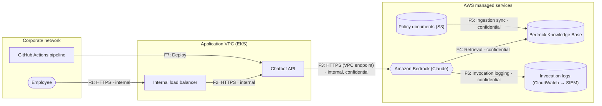

# Threat Model: Employee GenAI Assistant

| | |
|---|---|
| **Generated** | 2026-11-06 |
| **Owner** | Digital Workplace team |
| **Stage** | design |
| **Criticality** | Medium |
| **Users** | employees, admins |
| **Regulatory scope** | GLBA |

Internal chatbot that answers employee questions using company policy and procedure documents. Runs on a shared EKS cluster and calls Amazon Bedrock through a VPC endpoint.

## Executive summary

**Overall residual risk: 🟠 High** (highest-rated threat that is not fully mitigated)

**Inherited platform controls (Private Hybrid Network, AWS Organization Guardrails):** 6 threats fully mitigated by the platform and 4 more reduced. Overall residual risk would still be 🟠 High without them, but they take **6 High/Critical threats** off the go-live list. See *Inherited platform controls*.

| Rating | Open without platform controls | Open / partially mitigated | Mitigated |
|---|---|---|---|
| 🔴 Critical | 0 | 0 | 0 |
| 🟠 High | 12 | 6 | 0 |
| 🟡 Medium | 11 | 11 | 0 |
| 🟢 Low | 1 | 1 | 13 |

**Top risks to address:**

1. **Indirect prompt injection through retrieved content** on *Amazon Bedrock (Claude)* (🟠 High, open). Add: `content_write_controls`, `prompt_injection_filter`
1. **Sensitive information disclosure through the model** on *Amazon Bedrock (Claude)* (🟠 High, open). Add: `pii_filter`, `dlp`
1. **Retrieval returns data the user isn't allowed to see** on *Bedrock Knowledge Base* (🟠 High, open). Add: `permission_aware_retrieval`
1. **Unknown sensitive data in storage** on *Policy documents (S3)* (🟠 High, open). Add: `data_classification_scanning`
1. **Unknown sensitive data in storage** on *Bedrock Knowledge Base* (🟠 High, open). Add: `data_classification_scanning`

⚠️ The intake left **1 open question** (see *Questions for the app team*). Answering them may add or change findings.

## Scope

| Component | Type | Zone | Platform | Internet-facing | Data | App team controls | Inherited controls |
|---|---|---|---|---|---|---|---|
| **Employee** (`employee`) | user | corp | — | No | — | — | — |
| **Internal load balancer** (`alb`) | load_balancer | app-vpc | — | No | — | sso, mfa, tls | segmentation |
| **Chatbot API** (`chatbot-api`) | container_workload | app-vpc | — | No | internal, confidential | admission_control, non_root, network_policy | egress_control, image_scanning, runtime_detection, segmentation, vuln_scanning, workload_identity |
| **Amazon Bedrock (Claude)** (`bedrock`) | llm | aws-managed | — | No | — | guardrails, model_allowlist, invocation_logging | private_endpoint, segmentation |
| **Bedrock Knowledge Base** (`knowledge-base`) | vector_store | aws-managed | — | No | internal, confidential | guardrails, model_allowlist, invocation_logging | encryption_cmk, private_endpoint, segmentation |
| **Policy documents (S3)** (`docs-bucket`) | object_storage | aws-managed | — | No | internal, confidential | — | encryption_cmk, private_endpoint, public_access_block, segmentation |
| **Invocation logs (CloudWatch → SIEM)** (`logs`) | logging | aws-managed | — | No | confidential | — | log_immutability, restricted_log_access, segmentation |
| **GitHub Actions pipeline** (`pipeline`) | ci_cd | corp | — | No | — | branch_protection, deploy_approvals, secrets_scanning | workload_identity |

**Application-wide controls** (apply to every component): `sso`, `audit_logging`, `logging_siem`

## Inherited platform controls

Controls the app team gets from the cloud platforms it builds on. **Preventive** controls are guardrails that block non-compliant deployments; **detective** controls catch drift after the fact, so they reduce a threat but never fully mitigate it on their own. The platform team owns these controls and their evidence.

### Private Hybrid Network (`aws-network`)

Applies to: whole application · Owner: Network / Infrastructure team · Builds on: `aws-org`

Private VPCs connected to the hybrid network, inheriting the enterprise network perimeter. Access to AWS services goes through VPC endpoints in shared services infrastructure, with endpoint policies on data services. Builds on the AWS Organization Guardrails.

| Control | Covers | Enforcement | Mechanism | Evidence |
|---|---|---|---|---|
| `egress_control` | web_app, api, container_workload, vm, ai_agent | Preventive | Private VPCs without direct internet egress; outbound traffic goes through the hybrid network perimeter, and VPC endpoint policies restrict AWS API calls to org-owned resources | Network architecture standard; perimeter firewall / proxy policy; VPCE policy IDs |
| `private_endpoint` | database, object_storage, vector_store, queue, secrets_store, llm | Preventive | VPC endpoint use enforced through shared services infrastructure, with VPC endpoint policies on data services | Shared services VPCE inventory; SCP/resource policy aws:SourceVpce conditions |

### AWS Organization Guardrails (`aws-org`)

Applies to: inherited by another platform · Owner: Cloud Security / Cloud Platform Engineering

Organization-wide preventive guardrails (SCP allow/deny lists for services and actions, RCPs that only trust our org ID and approved external IDs), federated identity, an OU structure that separates workloads from security and infrastructure accounts, enforced encryption, automatic enrollment in security tooling, and protected enterprise logging. Permissions boundaries are required on every role a workload creates.

| Control | Covers | Enforcement | Mechanism | Evidence |
|---|---|---|---|---|
| `segmentation` | web_app, api, api_gateway, load_balancer, container_workload, serverless_function, vm, database, object_storage, queue, secrets_store, vector_store, llm, ai_agent, logging | Preventive | OU structure separates workload accounts from security and infrastructure accounts; SCPs applied per OU | AWS Organizations OU structure; SCP attachments per OU |
| `public_access_block` | object_storage, queue, secrets_store | Preventive | RCPs deny access to principals outside our org ID, except approved external IDs (covers S3, SQS, Secrets Manager, KMS, STS) | RCP policy IDs; approved external ID register |
| `encryption_cmk` | database, object_storage, vector_store, queue, secrets_store | Preventive | Encryption at rest with customer-managed KMS keys enforced by SCP | SCP policy ID; Config / CNAPP encryption findings |
| `tls` | flow | Preventive | Encryption in transit (SSL/TLS) enforced, e.g. aws:SecureTransport deny in SCPs/RCPs and resource policies | SCP / RCP policy IDs |
| `workload_identity` | web_app, api, container_workload, serverless_function, vm, ai_agent | Preventive | Workloads authenticate with IAM roles, not static keys; roles can only be created with the required permissions boundary | SCP requiring the permissions boundary on iam:CreateRole; IAM users / access keys denied (confirm) |
| `workload_identity` | ci_cd | Preventive | Pipeline roles assumed through OIDC federated via the IdP; no long-lived pipeline credentials | IAM OIDC provider config; pipeline role trust policies |
| `mfa` | app | Preventive | Human access to AWS is federated through the corporate IdP with MFA (workforce users, not app end users) | IdP conditional access / MFA policy; IAM Identity Center config |
| `runtime_detection` | vm, container_workload, serverless_function | Preventive | Accounts auto-enrolled in GuardDuty and the CNAPP at vending; SCP prevents disabling them | GuardDuty delegated admin; CNAPP account coverage report |
| `vuln_scanning` | vm, container_workload, serverless_function | Detective | CNAPP scans every account automatically; findings routed to owners | CNAPP vulnerability dashboard |
| `image_scanning` | container_workload | Detective | CNAPP scans container images and registries (reports, does not block deploys) | CNAPP image scanning dashboard |
| `audit_logging` | app | Preventive | CloudTrail, Config, and Security Hub auto-enabled in every account | Org trail and Config aggregator; Security Hub delegated admin |
| `logging_siem` | app | Preventive | Enterprise logging solution ensures cloud logs are ingested into the SIEM | SIEM ingestion health dashboard |
| `log_immutability` | logging | Preventive | Enterprise logging infrastructure is protected by SCPs so no one outside the logging team can alter or disable it | SCP policy ID protecting logging resources |
| `restricted_log_access` | logging | Preventive | Logging infrastructure and log data access limited to the logging/security team | Log archive account access policy |

## Data flow diagram

Boxes are trust zones. Dotted arrows are unencrypted flows.

### Trust boundary crossings

Threats concentrate where data crosses between zones.

| Flow | From → To | Zones | Protocol | Data | Encrypted | Authenticated |
|---|---|---|---|---|---|---|
| F1 | Employee → Internal load balancer | corp → app-vpc | HTTPS | internal | Yes | Yes |
| F3 | Chatbot API → Amazon Bedrock (Claude) | app-vpc → aws-managed | HTTPS (VPC endpoint) | internal, confidential | Yes | Yes |
| F7 | GitHub Actions pipeline → Chatbot API | corp → app-vpc | Deploy | — | Yes | Yes |

## Threat register

Sorted by risk score (likelihood × impact, 1–25). ⬇ platform = inherited platform controls changed the status.

| ID | Risk | Threat | Target | STRIDE | L | I | Score | Status | Missing controls |
|---|---|---|---|---|---|---|---|---|---|
| T-001 | 🟠 High | Indirect prompt injection through retrieved content | Amazon Bedrock (Claude) | T | 3 | 4 | **12** | Open | content_write_controls, prompt_injection_filter |
| T-002 | 🟠 High | Sensitive information disclosure through the model | Amazon Bedrock (Claude) | I | 3 | 4 | **12** | Open | pii_filter, dlp |
| T-003 | 🟠 High | Retrieval returns data the user isn't allowed to see | Bedrock Knowledge Base | I | 3 | 4 | **12** | Open | permission_aware_retrieval |
| T-004 | 🟠 High | Unknown sensitive data in storage | Policy documents (S3) | I | 3 | 4 | **12** | Open | data_classification_scanning |
| T-005 | 🟠 High | Unknown sensitive data in storage | Bedrock Knowledge Base | I | 3 | 4 | **12** | Open | data_classification_scanning |
| T-006 | 🟠 High | Over-privileged workload identity | Chatbot API | E | 3 | 4 | **12** | Open | least_privilege_iam |
| T-007 | 🟡 Medium | Pipeline compromise or unauthorized deployment | GitHub Actions pipeline | TE | 2 | 5 | **10** | Partially mitigated | least_privilege_iam |
| T-008 | 🟡 Medium | Privileged / admin access without strong controls | Employee GenAI Assistant | SE | 2 | 5 | **10** | Partially mitigated ⬇ platform | privileged_access_management |
| T-009 | 🟡 Medium | Direct prompt injection and jailbreaks | Amazon Bedrock (Claude) | TE | 3 | 3 | **9** | Partially mitigated | prompt_injection_filter |
| T-010 | 🟡 Medium | Model output trusted by downstream systems | Amazon Bedrock (Claude) | TE | 3 | 3 | **9** | Open | output_validation |
| T-011 | 🟡 Medium | Infrastructure misconfiguration reaches production | GitHub Actions pipeline | TI | 3 | 3 | **9** | Open | iac_scanning |
| T-012 | 🟡 Medium | Vulnerable container images | Chatbot API | TE | 3 | 3 | **9** | Partially mitigated ⬇ platform | patching |
| T-013 | 🟡 Medium | Data destruction or ransomware | Policy documents (S3) | TD | 2 | 4 | **8** | Open | backups, object_lock |
| T-014 | 🟡 Medium | Long-lived static credentials in workloads | Chatbot API | SI | 2 | 4 | **8** | Partially mitigated ⬇ platform | secrets_manager |
| T-015 | 🟡 Medium | Unbounded consumption and cost abuse | Amazon Bedrock (Claude) | D | 3 | 2 | **6** | Open | token_quota, rate_limiting |
| T-016 | 🟡 Medium | System prompt leakage | Amazon Bedrock (Claude) | I | 3 | 2 | **6** | Open | no_secrets_in_prompts |
| T-017 | 🟡 Medium | Sensitive data written to logs | Invocation logs (CloudWatch → SIEM) | I | 2 | 3 | **6** | Partially mitigated ⬇ platform | log_redaction |
| T-018 | 🟢 Low | Container escape via privileged or root containers | Chatbot API | E | 1 | 5 | **5** | Mitigated | — |
| T-019 | 🟢 Low | Data store reachable from public networks | Amazon Bedrock (Claude) | I | 1 | 5 | **5** | Mitigated ⬇ platform | — |
| T-020 | 🟢 Low | Data store reachable from public networks | Policy documents (S3) | I | 1 | 5 | **5** | Mitigated ⬇ platform | — |
| T-021 | 🟢 Low | Data store reachable from public networks | Bedrock Knowledge Base | I | 1 | 5 | **5** | Mitigated ⬇ platform | — |
| T-022 | 🟢 Low | Untrusted or tampered container images | Chatbot API | T | 1 | 4 | **4** | Partially mitigated | image_signing |
| T-023 | 🟢 Low | Unapproved or compromised models | Amazon Bedrock (Claude) | T | 1 | 4 | **4** | Mitigated | — |
| T-024 | 🟢 Low | Weak or missing user authentication | Internal load balancer | S | 1 | 4 | **4** | Mitigated | — |
| T-025 | 🟢 Low | Uncontrolled outbound traffic enables data exfiltration | Chatbot API | I | 1 | 4 | **4** | Mitigated ⬇ platform | — |
| T-026 | 🟢 Low | Secrets committed to code or configuration | GitHub Actions pipeline | I | 1 | 4 | **4** | Mitigated | — |
| T-027 | 🟢 Low | AI activity not logged for investigation | Amazon Bedrock (Claude) | R | 1 | 3 | **3** | Mitigated | — |
| T-028 | 🟢 Low | Malicious activity in running containers goes undetected | Chatbot API | RT | 1 | 3 | **3** | Mitigated ⬇ platform | — |
| T-029 | 🟢 Low | Insufficient audit logging | Employee GenAI Assistant | R | 1 | 3 | **3** | Mitigated | — |
| T-030 | 🟢 Low | Logs can be altered or disabled | Invocation logs (CloudWatch → SIEM) | R | 1 | 3 | **3** | Mitigated ⬇ platform | — |
| T-031 | 🟢 Low | Lateral movement between workloads | Chatbot API | E | 1 | 3 | **3** | Mitigated | — |

## Required before go-live

Critical and High threats that are not fully mitigated. Fix these, or document a risk acceptance with a named owner and an expiry date.

| ID | Threat | Target | Controls to add |
|---|---|---|---|
| T-001 | Indirect prompt injection through retrieved content | Amazon Bedrock (Claude) | content_write_controls, prompt_injection_filter |
| T-002 | Sensitive information disclosure through the model | Amazon Bedrock (Claude) | pii_filter, dlp |
| T-003 | Retrieval returns data the user isn't allowed to see | Bedrock Knowledge Base | permission_aware_retrieval |
| T-004 | Unknown sensitive data in storage | Policy documents (S3) | data_classification_scanning |
| T-005 | Unknown sensitive data in storage | Bedrock Knowledge Base | data_classification_scanning |
| T-006 | Over-privileged workload identity | Chatbot API | least_privilege_iam |

## Threat details

### T-001 · Indirect prompt injection through retrieved content

**🟠 High** · score 12 (L3 × I4) · Open · rule `AI-02`

- **Target:** Amazon Bedrock (Claude) (component)
- **STRIDE:** Tampering
- **Threat:** Instructions hidden in documents, emails, or web pages that the model reads can change its behavior. There is no complete fix; limit who can write content and what the model can do.
- **Recommended mitigations:**
  - `content_write_controls`: Only approved people and processes can add knowledge-base content
  - `prompt_injection_filter`: Prompt attack / injection detection (e.g. Prompt Shields)
- **References:** OWASP LLM01:2025 Prompt Injection

### T-002 · Sensitive information disclosure through the model

**🟠 High** · score 12 (L3 × I4) · Open · rule `AI-03`

- **Target:** Amazon Bedrock (Claude) (component)
- **STRIDE:** Information disclosure
- **Threat:** Prompts and responses can contain PII or confidential data, whether typed by users or pulled in from retrieval.
- **Recommended mitigations:**
  - `pii_filter`: PII detection and masking on prompts and responses
  - `dlp`: Data loss prevention on content
- **References:** OWASP LLM02:2025 Sensitive Information Disclosure

### T-003 · Retrieval returns data the user isn't allowed to see

**🟠 High** · score 12 (L3 × I4) · Open · rule `AI-04`

- **Target:** Bedrock Knowledge Base (component)
- **STRIDE:** Information disclosure
- **Threat:** If retrieval uses the application's access instead of the user's, any user can get answers drawn from any document in the knowledge base.
- **Recommended mitigations:**
  - `permission_aware_retrieval`: Retrieval filtered by the requesting user's entitlements
- **References:** OWASP LLM08:2025 Vector and Embedding Weaknesses

### T-004 · Unknown sensitive data in storage

**🟠 High** · score 12 (L3 × I4) · Open · rule `DA-02`

- **Target:** Policy documents (S3) (component)
- **STRIDE:** Information disclosure
- **Threat:** Teams often store more sensitive data than they realize (e.g. PII in documents or exports). Without scanning, it isn't protected or classified correctly.
- **Recommended mitigations:**
  - `data_classification_scanning`: Scanned for sensitive data (Macie, Purview, Sensitive Data Protection)
- **References:** Amazon Macie / Microsoft Purview / GCP Sensitive Data Protection

### T-005 · Unknown sensitive data in storage

**🟠 High** · score 12 (L3 × I4) · Open · rule `DA-02`

- **Target:** Bedrock Knowledge Base (component)
- **STRIDE:** Information disclosure
- **Threat:** Teams often store more sensitive data than they realize (e.g. PII in documents or exports). Without scanning, it isn't protected or classified correctly.
- **Recommended mitigations:**
  - `data_classification_scanning`: Scanned for sensitive data (Macie, Purview, Sensitive Data Protection)
- **References:** Amazon Macie / Microsoft Purview / GCP Sensitive Data Protection

### T-006 · Over-privileged workload identity

**🟠 High** · score 12 (L3 × I4) · Open · rule `ID-04`

- **Target:** Chatbot API (component)
- **STRIDE:** Elevation of privilege
- **Threat:** If the workload's role has broader permissions than it needs, any compromise of the workload becomes a compromise of everything that role can reach.
- **Recommended mitigations:**
  - `least_privilege_iam`: IAM roles scoped to exactly what the component needs
- **References:** MITRE ATT&CK T1078.004 Cloud Accounts

### T-007 · Pipeline compromise or unauthorized deployment

**🟡 Medium** · score 10 (L2 × I5) · Partially mitigated · rule `CI-01`

- **Target:** GitHub Actions pipeline (component)
- **STRIDE:** Tampering, Elevation of privilege
- **Threat:** The pipeline can change production. A compromised pipeline, developer account, or workflow can push malicious code or infrastructure changes.
- **Controls in place:** branch_protection (app team), deploy_approvals (app team)
- **Recommended mitigations:**
  - `least_privilege_iam`: IAM roles scoped to exactly what the component needs
- **Score adjustments:** -1 likelihood: some listed controls in place
- **References:** MITRE ATT&CK T1195 Supply Chain Compromise; OWASP Top 10 CI/CD Security Risks

### T-008 · Privileged / admin access without strong controls

**🟡 Medium** · score 10 (L2 × I5) · Partially mitigated · rule `ID-02`

- **Target:** Employee GenAI Assistant (app)
- **STRIDE:** Spoofing, Elevation of privilege
- **Threat:** Administrators or support staff have elevated access. Compromise of one admin account can expose the whole application and its data.
- **Controls in place:** mfa (inherited: AWS Organization Guardrails, preventive)
- **Without platform controls:** 🟠 High (score 15, open)
- **Recommended mitigations:**
  - `privileged_access_management`: Just-in-time, approved, logged admin access
- **Score adjustments:** -1 likelihood: some listed controls in place
- **References:** MITRE ATT&CK T1078.004 Cloud Accounts

### T-009 · Direct prompt injection and jailbreaks

**🟡 Medium** · score 9 (L3 × I3) · Partially mitigated · rule `AI-01`

- **Target:** Amazon Bedrock (Claude) (component)
- **STRIDE:** Tampering, Elevation of privilege
- **Threat:** Users can craft prompts that override the system's instructions or safety rules.
- **Controls in place:** guardrails (app team)
- **Recommended mitigations:**
  - `prompt_injection_filter`: Prompt attack / injection detection (e.g. Prompt Shields)
- **Score adjustments:** -1 likelihood: some listed controls in place
- **References:** OWASP LLM01:2025 Prompt Injection

### T-010 · Model output trusted by downstream systems

**🟡 Medium** · score 9 (L3 × I3) · Open · rule `AI-06`

- **Target:** Amazon Bedrock (Claude) (component)
- **STRIDE:** Tampering, Elevation of privilege
- **Threat:** If model output is rendered in a browser or passed to code, SQL, or APIs without validation, it can cause XSS, injection, or unintended actions.
- **Recommended mitigations:**
  - `output_validation`: Model output validated or encoded before use
- **References:** OWASP LLM05:2025 Improper Output Handling

### T-011 · Infrastructure misconfiguration reaches production

**🟡 Medium** · score 9 (L3 × I3) · Open · rule `CI-02`

- **Target:** GitHub Actions pipeline (component)
- **STRIDE:** Tampering, Information disclosure
- **Threat:** Without IaC scanning, insecure Terraform (public buckets, open security groups) is deployed and only found later by CSPM, if at all.
- **Recommended mitigations:**
  - `iac_scanning`: IaC scanned in the pipeline (Checkov, Wiz Code, Trivy)
- **References:** Checkov / Wiz Code / Trivy config

### T-012 · Vulnerable container images

**🟡 Medium** · score 9 (L3 × I3) · Partially mitigated · rule `CT-01`

- **Target:** Chatbot API (component)
- **STRIDE:** Tampering, Elevation of privilege
- **Threat:** Images built on outdated or bloated base images carry exploitable CVEs into production.
- **Controls in place:** image_scanning (inherited: AWS Organization Guardrails, detective)
- **Without platform controls:** 🟠 High (score 12, open)
- **Recommended mitigations:**
  - `patching`: Patching within defined SLAs
- **Score adjustments:** -1 likelihood: some listed controls in place
- **References:** CIS Kubernetes Benchmark; NIST SP 800-190

### T-013 · Data destruction or ransomware

**🟡 Medium** · score 8 (L2 × I4) · Open · rule `DA-03`

- **Target:** Policy documents (S3) (component)
- **STRIDE:** Tampering, Denial of service
- **Threat:** An attacker or mistake could delete or encrypt the data. Without protected backups, recovery may be impossible.
- **Recommended mitigations:**
  - `backups`: Backups isolated from production and tested
  - `object_lock`: Write-once / immutable storage for critical data
- **References:** MITRE ATT&CK T1485 Data Destruction

### T-014 · Long-lived static credentials in workloads

**🟡 Medium** · score 8 (L2 × I4) · Partially mitigated · rule `ID-03`

- **Target:** Chatbot API (component)
- **STRIDE:** Spoofing, Information disclosure
- **Threat:** Workloads that use static keys or passwords can have them leaked through code, images, logs, or environment variables, and the keys keep working until someone rotates them.
- **Controls in place:** workload_identity (inherited: AWS Organization Guardrails, preventive)
- **Without platform controls:** 🟠 High (score 12, open)
- **Recommended mitigations:**
  - `secrets_manager`: Secrets pulled from a secrets manager, not stored in code or config
- **Score adjustments:** -1 likelihood: some listed controls in place
- **References:** MITRE ATT&CK T1552 Unsecured Credentials

### T-015 · Unbounded consumption and cost abuse

**🟡 Medium** · score 6 (L3 × I2) · Open · rule `AI-08`

- **Target:** Amazon Bedrock (Claude) (component)
- **STRIDE:** Denial of service
- **Threat:** Heavy or abusive use can run up large costs or exhaust quotas for everyone.
- **Recommended mitigations:**
  - `token_quota`: Token quotas / budgets per user or app
  - `rate_limiting`: Rate limits per client or user
- **References:** OWASP LLM10:2025 Unbounded Consumption

### T-016 · System prompt leakage

**🟡 Medium** · score 6 (L3 × I2) · Open · rule `AI-11`

- **Target:** Amazon Bedrock (Claude) (component)
- **STRIDE:** Information disclosure
- **Threat:** Attackers can often extract the system prompt. Secrets or access rules placed in it will be exposed.
- **Recommended mitigations:**
  - `no_secrets_in_prompts`: No secrets or authorization logic in system prompts
- **References:** OWASP LLM07:2025 System Prompt Leakage

### T-017 · Sensitive data written to logs

**🟡 Medium** · score 6 (L2 × I3) · Partially mitigated · rule `DA-04`

- **Target:** Invocation logs (CloudWatch → SIEM) (component)
- **STRIDE:** Information disclosure
- **Threat:** Logs often capture request bodies, tokens, or AI prompts. They are usually readable by more people than the source data.
- **Controls in place:** restricted_log_access (inherited: AWS Organization Guardrails, preventive)
- **Without platform controls:** 🟡 Medium (score 9, open)
- **Recommended mitigations:**
  - `log_redaction`: Sensitive fields redacted before logging
- **Score adjustments:** -1 likelihood: some listed controls in place
- **References:** OWASP Logging Cheat Sheet

### T-022 · Untrusted or tampered container images

**🟢 Low** · score 4 (L1 × I4) · Partially mitigated · rule `CT-02`

- **Target:** Chatbot API (component)
- **STRIDE:** Tampering
- **Threat:** Without signing and admission checks, an attacker or mistake can deploy an image that didn't come from the approved pipeline.
- **Controls in place:** admission_control (app team)
- **Recommended mitigations:**
  - `image_signing`: Container images signed and verified
- **Score adjustments:** -1 likelihood: some listed controls in place
- **References:** MITRE ATT&CK T1195 Supply Chain Compromise; SLSA

### Mitigated threats

These threats apply to the design, and all listed controls are in place. App team controls are self-reported, so verify them (e.g. CSPM findings, config review). Inherited controls are verified through the platform's evidence.

- T-018 · **Container escape via privileged or root containers** on *Chatbot API* (residual Low, controls: admission_control (app team), non_root (app team))
- T-019 · **Data store reachable from public networks** on *Amazon Bedrock (Claude)* (residual Low, controls: private_endpoint (inherited: Private Hybrid Network, preventive))
- T-020 · **Data store reachable from public networks** on *Policy documents (S3)* (residual Low, controls: private_endpoint (inherited: Private Hybrid Network, preventive), public_access_block (inherited: AWS Organization Guardrails, preventive))
- T-021 · **Data store reachable from public networks** on *Bedrock Knowledge Base* (residual Low, controls: private_endpoint (inherited: Private Hybrid Network, preventive))
- T-023 · **Unapproved or compromised models** on *Amazon Bedrock (Claude)* (residual Low, controls: model_allowlist (app team))
- T-024 · **Weak or missing user authentication** on *Internal load balancer* (residual Low, controls: sso (app team), mfa (app team))
- T-025 · **Uncontrolled outbound traffic enables data exfiltration** on *Chatbot API* (residual Low, controls: egress_control (inherited: Private Hybrid Network, preventive))
- T-026 · **Secrets committed to code or configuration** on *GitHub Actions pipeline* (residual Low, controls: secrets_scanning (app team))
- T-027 · **AI activity not logged for investigation** on *Amazon Bedrock (Claude)* (residual Low, controls: invocation_logging (app team))
- T-028 · **Malicious activity in running containers goes undetected** on *Chatbot API* (residual Low, controls: runtime_detection (inherited: AWS Organization Guardrails, preventive))
- T-029 · **Insufficient audit logging** on *Employee GenAI Assistant* (residual Low, controls: audit_logging (inherited: AWS Organization Guardrails, preventive), logging_siem (inherited: AWS Organization Guardrails, preventive))
- T-030 · **Logs can be altered or disabled** on *Invocation logs (CloudWatch → SIEM)* (residual Low, controls: log_immutability (inherited: AWS Organization Guardrails, preventive), restricted_log_access (inherited: AWS Organization Guardrails, preventive))
- T-031 · **Lateral movement between workloads** on *Chatbot API* (residual Low, controls: network_policy (app team), segmentation (inherited: AWS Organization Guardrails, preventive))

## Questions for the app team

**Missing from the intake:**

- [ ] What data moves on flow F7 (GitHub Actions pipeline → Chatbot API)? Set `data`.

**To confirm during the review:**

*Amazon Bedrock (Claude)*
- [ ] Who can add or edit documents in the knowledge base?
- [ ] Are PII filters applied to prompts and responses?
- [ ] Which guardrails are enabled, and has the app been red-teamed?
- [ ] Where does model output go, and is it encoded or validated first?
- [ ] Are there per-user rate limits and token quotas?
- [ ] Does the system prompt contain any secrets, keys, or authorization logic?

*Bedrock Knowledge Base*
- [ ] Are retrieval results filtered by the requesting user's entitlements?
- [ ] Is this store scanned for sensitive data?

*Policy documents (S3)*
- [ ] Is this store scanned for sensitive data?
- [ ] Are backups isolated from the production account and tested?

*Chatbot API*
- [ ] What exactly can this workload's IAM role / managed identity do?
- [ ] Which base images are used, and does the pipeline fail on critical CVEs?
- [ ] How does this workload authenticate to cloud services and databases?
- [ ] Can only signed images from approved registries run?

*GitHub Actions pipeline*
- [ ] Who can merge and deploy to production? Are approvals required?
- [ ] Is Terraform scanned in the pipeline, and can it block a deploy?

*Employee GenAI Assistant*
- [ ] Who has admin or production access, and is it just-in-time and logged?

*Invocation logs (CloudWatch → SIEM)*
- [ ] What sensitive fields can end up in logs, and who can read them?

## Method

- Threats come from a rule-based library (STRIDE, OWASP Top 10 for LLM Applications 2025, cloud and container threats). Each rule fires when the architecture matches its conditions.
- **Likelihood and impact** start from the rule's base score (1–5), then: +1 likelihood if internet-facing; +1 impact for highly sensitive data (restricted, customer PII, PCI, credentials); ±1 impact for high/low application criticality; −1 likelihood if some listed controls are in place, −2 if all are.
- **Inherited controls** from the platform baseline count the same as app team controls, except that detective-only coverage can't fully mitigate a threat. Each finding is also scored without them, to show what the platforms contribute.
- **Ratings:** Critical 20–25 · High 12–19 · Medium 6–11 · Low 1–5.
- This is a starting point for a threat modeling session, not a replacement for one. Controls are as reported by the app team and should be verified.
