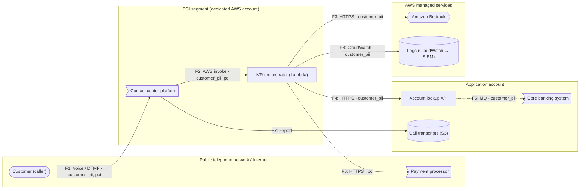

# Threat Model: Contact Center IVR Assistant

| | |
|---|---|
| **Generated** | 2026-11-06 |
| **Owner** | Contact Center Technology |
| **Stage** | build |
| **Criticality** | High |
| **Users** | customers, admins |
| **Regulatory scope** | PCI, GLBA |

Customer-facing voice assistant for the contact center. Handles account questions and can take card payments. Uses Bedrock to understand intent and look up account information.

## Executive summary

**Overall residual risk: 🔴 Critical** (highest-rated threat that is not fully mitigated)

| Rating | Open / partially mitigated | Mitigated |
|---|---|---|
| 🔴 Critical | 3 | 0 |
| 🟠 High | 18 | 0 |
| 🟡 Medium | 10 | 0 |
| 🟢 Low | 0 | 7 |

**Top risks to address:**

1. **Exploitation of internet-facing component** on *Contact center platform* (🔴 Critical, open). Add: `waf`, `vuln_scanning`, `patching`
1. **Weak or missing user authentication** on *Contact center platform* (🔴 Critical, open). Add: `sso`, `mfa`
1. **Denial of service on internet-facing component** on *Contact center platform* (🔴 Critical, open). Add: `rate_limiting`, `waf`, `autoscaling`
1. **Direct prompt injection and jailbreaks** on *Amazon Bedrock* (🟠 High, partially mitigated). Add: `prompt_injection_filter`
1. **Sensitive information disclosure through the model** on *Amazon Bedrock* (🟠 High, open). Add: `pii_filter`, `dlp`

⚠️ The intake left **5 open questions** (see *Questions for the app team*). Answering them may add or change findings.

## Scope

| Component | Type | Zone | Internet-facing | Data | Controls |
|---|---|---|---|---|---|
| **Customer (caller)** (`caller`) | user | internet | No | — | — |
| **Contact center platform** (`contact-center`) | saas | pci | Yes | customer_pii, pci | vendor_risk_assessment, segmentation |
| **IVR orchestrator (Lambda)** (`ivr-orchestrator`) | serverless_function | pci | No | customer_pii, pci | least_privilege_iam, segmentation |
| **Amazon Bedrock** (`bedrock`) | llm | aws-managed | No | — | guardrails, model_allowlist, invocation_logging, private_endpoint |
| **Account lookup API** (`account-api`) | api | app | No | customer_pii | service_auth |
| **Core banking system** (`core-banking`) | external_system | app | No | customer_pii | — |
| **Payment processor** (`payment-gateway`) | external_system | internet | No | pci | — |
| **Call transcripts (S3)** (`transcripts`) | object_storage | app | No | — | — |
| **Logs (CloudWatch → SIEM)** (`logs`) | logging | aws-managed | No | customer_pii | — |

**Application-wide controls** (apply to every component): `audit_logging`, `logging_siem`

## Data flow diagram

Boxes are trust zones. Dotted arrows are unencrypted flows.

### Trust boundary crossings

Threats concentrate where data crosses between zones.

| Flow | From → To | Zones | Protocol | Data | Encrypted | Authenticated |
|---|---|---|---|---|---|---|
| F1 | Customer (caller) → Contact center platform | internet → pci | Voice / DTMF | customer_pii, pci | Yes | **No** |
| F3 | IVR orchestrator (Lambda) → Amazon Bedrock | pci → aws-managed | HTTPS | customer_pii | Yes | Yes |
| F4 | IVR orchestrator (Lambda) → Account lookup API | pci → app | HTTPS | customer_pii | Yes | Unknown |
| F6 | IVR orchestrator (Lambda) → Payment processor | pci → internet | HTTPS | pci | Yes | Yes |
| F7 | Contact center platform → Call transcripts (S3) | pci → app | Export | — | Yes | Yes |
| F8 | IVR orchestrator (Lambda) → Logs (CloudWatch → SIEM) | pci → aws-managed | CloudWatch | customer_pii | Yes | Yes |

## Threat register

Sorted by risk score (likelihood × impact, 1–25).

| ID | Risk | Threat | Target | STRIDE | L | I | Score | Status | Missing controls |
|---|---|---|---|---|---|---|---|---|---|
| T-001 | 🔴 Critical | Exploitation of internet-facing component | Contact center platform | TE | 5 | 5 | **25** | Open | waf, vuln_scanning, patching |
| T-002 | 🔴 Critical | Weak or missing user authentication | Contact center platform | S | 4 | 5 | **20** | Open | sso, mfa |
| T-003 | 🔴 Critical | Denial of service on internet-facing component | Contact center platform | D | 4 | 5 | **20** | Open | rate_limiting, waf, autoscaling |
| T-004 | 🟠 High | Direct prompt injection and jailbreaks | Amazon Bedrock | TE | 3 | 5 | **15** | Partially mitigated | prompt_injection_filter |
| T-005 | 🟠 High | Sensitive information disclosure through the model | Amazon Bedrock | I | 3 | 5 | **15** | Open | pii_filter, dlp |
| T-006 | 🟠 High | Excessive agency | Amazon Bedrock | E | 3 | 5 | **15** | Open | least_privilege_tools, human_approval |
| T-007 | 🟠 High | Model output trusted by downstream systems | Amazon Bedrock | TE | 3 | 5 | **15** | Open | output_validation |
| T-008 | 🟠 High | Unknown sensitive data in storage | Call transcripts (S3) | I | 3 | 5 | **15** | Open | data_classification_scanning |
| T-009 | 🟠 High | Sensitive data written to logs | Logs (CloudWatch → SIEM) | I | 3 | 5 | **15** | Open | log_redaction, restricted_log_access |
| T-010 | 🟠 High | Unencrypted data flow | F5: Account lookup API → Core banking system | IT | 3 | 5 | **15** | Open | one of: tls, mtls |
| T-011 | 🟠 High | Sensitive data sent to a third party | F1: Customer (caller) → Contact center platform | I | 3 | 5 | **15** | Open | vendor_risk_assessment, data_minimization, tokenization |
| T-012 | 🟠 High | Privileged / admin access without strong controls | Contact Center IVR Assistant | SE | 3 | 5 | **15** | Open | mfa, privileged_access_management |
| T-013 | 🟠 High | Long-lived static credentials in workloads | Account lookup API | SI | 3 | 5 | **15** | Open | workload_identity, secrets_manager |
| T-014 | 🟠 High | Long-lived static credentials in workloads | IVR orchestrator (Lambda) | SI | 3 | 5 | **15** | Open | workload_identity, secrets_manager |
| T-015 | 🟠 High | Over-privileged workload identity | Account lookup API | E | 3 | 5 | **15** | Open | least_privilege_iam |
| T-016 | 🟠 High | Broken object-level authorization | Account lookup API | EI | 3 | 5 | **15** | Open | authz_checks |
| T-017 | 🟠 High | Data store reachable from public networks | Call transcripts (S3) | I | 3 | 5 | **15** | Open | one of: private_endpoint, public_access_block |
| T-018 | 🟠 High | Card data captured in AI prompts or logs | Amazon Bedrock | I | 3 | 5 | **15** | Open | pci_data_masking |
| T-019 | 🟠 High | Card data captured in AI prompts or logs | Logs (CloudWatch → SIEM) | I | 3 | 5 | **15** | Open | pci_data_masking |
| T-020 | 🟠 High | Unbounded consumption and cost abuse | Amazon Bedrock | D | 3 | 4 | **12** | Open | token_quota, rate_limiting |
| T-021 | 🟠 High | System prompt leakage | Amazon Bedrock | I | 3 | 4 | **12** | Open | no_secrets_in_prompts |
| T-022 | 🟡 Medium | Single point of failure for a critical application | Account lookup API | D | 2 | 5 | **10** | Open | multi_az |
| T-023 | 🟡 Medium | Data destruction or ransomware | Call transcripts (S3) | TD | 2 | 5 | **10** | Open | backups, object_lock |
| T-024 | 🟡 Medium | Sensitive data sent to a third party | F5: Account lookup API → Core banking system | I | 2 | 5 | **10** | Open | vendor_risk_assessment, data_minimization, tokenization |
| T-025 | 🟡 Medium | Sensitive data sent to a third party | F6: IVR orchestrator (Lambda) → Payment processor | I | 2 | 5 | **10** | Open | vendor_risk_assessment, data_minimization, tokenization |
| T-026 | 🟡 Medium | Logs can be altered or disabled | Logs (CloudWatch → SIEM) | R | 2 | 5 | **10** | Open | log_immutability, restricted_log_access |
| T-027 | 🟡 Medium | Uncontrolled outbound traffic enables data exfiltration | Account lookup API | I | 2 | 5 | **10** | Open | egress_control |
| T-028 | 🟡 Medium | Uncontrolled outbound traffic enables data exfiltration | IVR orchestrator (Lambda) | I | 2 | 5 | **10** | Open | egress_control |
| T-029 | 🟡 Medium | Event injection into serverless function | IVR orchestrator (Lambda) | TE | 2 | 5 | **10** | Partially mitigated | input_validation |
| T-030 | 🟡 Medium | Vendor or SaaS handling sensitive data | Core banking system | I | 2 | 5 | **10** | Open | vendor_risk_assessment |
| T-031 | 🟡 Medium | Vendor or SaaS handling sensitive data | Payment processor | I | 2 | 5 | **10** | Open | vendor_risk_assessment |
| T-032 | 🟢 Low | Unapproved or compromised models | Amazon Bedrock | T | 1 | 5 | **5** | Mitigated | — |
| T-033 | 🟢 Low | AI activity not logged for investigation | Amazon Bedrock | R | 1 | 5 | **5** | Mitigated | — |
| T-034 | 🟢 Low | Over-privileged workload identity | IVR orchestrator (Lambda) | E | 1 | 5 | **5** | Mitigated | — |
| T-035 | 🟢 Low | Insufficient audit logging | Contact Center IVR Assistant | R | 1 | 5 | **5** | Mitigated | — |
| T-036 | 🟢 Low | Data store reachable from public networks | Amazon Bedrock | I | 1 | 5 | **5** | Mitigated | — |
| T-037 | 🟢 Low | Cardholder data environment not segmented | IVR orchestrator (Lambda) | IE | 1 | 5 | **5** | Mitigated | — |
| T-038 | 🟢 Low | Vendor or SaaS handling sensitive data | Contact center platform | I | 1 | 5 | **5** | Mitigated | — |

## Required before go-live

Critical and High threats that are not fully mitigated. Fix these, or document a risk acceptance with a named owner and an expiry date.

| ID | Threat | Target | Controls to add |
|---|---|---|---|
| T-001 | Exploitation of internet-facing component | Contact center platform | waf, vuln_scanning, patching |
| T-002 | Weak or missing user authentication | Contact center platform | sso, mfa |
| T-003 | Denial of service on internet-facing component | Contact center platform | rate_limiting, waf, autoscaling |
| T-004 | Direct prompt injection and jailbreaks | Amazon Bedrock | prompt_injection_filter |
| T-005 | Sensitive information disclosure through the model | Amazon Bedrock | pii_filter, dlp |
| T-006 | Excessive agency | Amazon Bedrock | least_privilege_tools, human_approval |
| T-007 | Model output trusted by downstream systems | Amazon Bedrock | output_validation |
| T-008 | Unknown sensitive data in storage | Call transcripts (S3) | data_classification_scanning |
| T-009 | Sensitive data written to logs | Logs (CloudWatch → SIEM) | log_redaction, restricted_log_access |
| T-010 | Unencrypted data flow | F5: Account lookup API → Core banking system | one of: tls, mtls |
| T-011 | Sensitive data sent to a third party | F1: Customer (caller) → Contact center platform | vendor_risk_assessment, data_minimization, tokenization |
| T-012 | Privileged / admin access without strong controls | Contact Center IVR Assistant | mfa, privileged_access_management |
| T-013 | Long-lived static credentials in workloads | Account lookup API | workload_identity, secrets_manager |
| T-014 | Long-lived static credentials in workloads | IVR orchestrator (Lambda) | workload_identity, secrets_manager |
| T-015 | Over-privileged workload identity | Account lookup API | least_privilege_iam |
| T-016 | Broken object-level authorization | Account lookup API | authz_checks |
| T-017 | Data store reachable from public networks | Call transcripts (S3) | one of: private_endpoint, public_access_block |
| T-018 | Card data captured in AI prompts or logs | Amazon Bedrock | pci_data_masking |
| T-019 | Card data captured in AI prompts or logs | Logs (CloudWatch → SIEM) | pci_data_masking |
| T-020 | Unbounded consumption and cost abuse | Amazon Bedrock | token_quota, rate_limiting |
| T-021 | System prompt leakage | Amazon Bedrock | no_secrets_in_prompts |

## Threat details

### T-001 · Exploitation of internet-facing component

**🔴 Critical** · score 25 (L5 × I5) · Open · rule `NW-01`

- **Target:** Contact center platform (component)
- **STRIDE:** Tampering, Elevation of privilege
- **Threat:** Internet-facing components are continuously scanned and attacked. Unpatched vulnerabilities or injection flaws can give an attacker a foothold.
- **Recommended mitigations:**
  - `waf`: Web application firewall in front of the component
  - `vuln_scanning`: Regular vulnerability scanning
  - `patching`: Patching within defined SLAs
- **Score adjustments:** +1 likelihood: internet-facing; +1 impact: highly sensitive data (customer_pii, pci); +1 impact: high-criticality application
- **References:** MITRE ATT&CK T1190 Exploit Public-Facing Application

### T-002 · Weak or missing user authentication

**🔴 Critical** · score 20 (L4 × I5) · Open · rule `ID-01`

- **Target:** Contact center platform (component)
- **STRIDE:** Spoofing
- **Threat:** Users reach this entry point. Without strong authentication, an attacker can impersonate a user with stolen or guessed credentials.
- **Recommended mitigations:**
  - `sso`: Single sign-on through the corporate or customer identity provider
  - `mfa`: Multi-factor authentication enforced
- **Score adjustments:** +1 likelihood: internet-facing; +1 impact: highly sensitive data (customer_pii, pci); +1 impact: high-criticality application
- **References:** MITRE ATT&CK T1078 Valid Accounts; NIST CSF PR.AA

### T-003 · Denial of service on internet-facing component

**🔴 Critical** · score 20 (L4 × I5) · Open · rule `NW-02`

- **Target:** Contact center platform (component)
- **STRIDE:** Denial of service
- **Threat:** Traffic floods or abusive clients can make the service unavailable.
- **Recommended mitigations:**
  - `rate_limiting`: Rate limits per client or user
  - `waf`: Web application firewall in front of the component
  - `autoscaling`: Autoscaling to absorb load
- **Score adjustments:** +1 likelihood: internet-facing; +1 impact: highly sensitive data (customer_pii, pci); +1 impact: high-criticality application
- **References:** MITRE ATT&CK T1498 Network Denial of Service

### T-004 · Direct prompt injection and jailbreaks

**🟠 High** · score 15 (L3 × I5) · Partially mitigated · rule `AI-01`

- **Target:** Amazon Bedrock (component)
- **STRIDE:** Tampering, Elevation of privilege
- **Threat:** Users can craft prompts that override the system's instructions or safety rules.
- **Controls in place:** guardrails
- **Recommended mitigations:**
  - `prompt_injection_filter`: Prompt attack / injection detection (e.g. Prompt Shields)
- **Score adjustments:** +1 impact: highly sensitive data (customer_pii); +1 impact: high-criticality application; -1 likelihood: some listed controls in place
- **References:** OWASP LLM01:2025 Prompt Injection

### T-005 · Sensitive information disclosure through the model

**🟠 High** · score 15 (L3 × I5) · Open · rule `AI-03`

- **Target:** Amazon Bedrock (component)
- **STRIDE:** Information disclosure
- **Threat:** Prompts and responses can contain PII or confidential data, whether typed by users or pulled in from retrieval.
- **Recommended mitigations:**
  - `pii_filter`: PII detection and masking on prompts and responses
  - `dlp`: Data loss prevention on content
- **Score adjustments:** +1 impact: highly sensitive data (customer_pii); +1 impact: high-criticality application
- **References:** OWASP LLM02:2025 Sensitive Information Disclosure

### T-006 · Excessive agency

**🟠 High** · score 15 (L3 × I5) · Open · rule `AI-05`

- **Target:** Amazon Bedrock (component)
- **STRIDE:** Elevation of privilege
- **Threat:** The AI can take actions (call APIs, change data, send messages). A manipulated or mistaken model can do real damage with whatever tools and permissions it has.
- **Recommended mitigations:**
  - `least_privilege_tools`: Agent tools limited to the minimum scopes needed
  - `human_approval`: Human approval required for high-impact AI actions
- **Score adjustments:** +1 impact: highly sensitive data (customer_pii); +1 impact: high-criticality application
- **References:** OWASP LLM06:2025 Excessive Agency

### T-007 · Model output trusted by downstream systems

**🟠 High** · score 15 (L3 × I5) · Open · rule `AI-06`

- **Target:** Amazon Bedrock (component)
- **STRIDE:** Tampering, Elevation of privilege
- **Threat:** If model output is rendered in a browser or passed to code, SQL, or APIs without validation, it can cause XSS, injection, or unintended actions.
- **Recommended mitigations:**
  - `output_validation`: Model output validated or encoded before use
- **Score adjustments:** +1 impact: highly sensitive data (customer_pii); +1 impact: high-criticality application
- **References:** OWASP LLM05:2025 Improper Output Handling

### T-008 · Unknown sensitive data in storage

**🟠 High** · score 15 (L3 × I5) · Open · rule `DA-02`

- **Target:** Call transcripts (S3) (component)
- **STRIDE:** Information disclosure
- **Threat:** Teams often store more sensitive data than they realize (e.g. PII in documents or exports). Without scanning, it isn't protected or classified correctly.
- **Recommended mitigations:**
  - `data_classification_scanning`: Scanned for sensitive data (Macie, Purview, Sensitive Data Protection)
- **Score adjustments:** +1 impact: high-criticality application
- **References:** Amazon Macie / Microsoft Purview / GCP Sensitive Data Protection

### T-009 · Sensitive data written to logs

**🟠 High** · score 15 (L3 × I5) · Open · rule `DA-04`

- **Target:** Logs (CloudWatch → SIEM) (component)
- **STRIDE:** Information disclosure
- **Threat:** Logs often capture request bodies, tokens, or AI prompts. They are usually readable by more people than the source data.
- **Recommended mitigations:**
  - `log_redaction`: Sensitive fields redacted before logging
  - `restricted_log_access`: Log access limited to those who need it
- **Score adjustments:** +1 impact: highly sensitive data (customer_pii); +1 impact: high-criticality application
- **References:** OWASP Logging Cheat Sheet

### T-010 · Unencrypted data flow

**🟠 High** · score 15 (L3 × I5) · Open · rule `FL-01`

- **Target:** F5: Account lookup API → Core banking system (flow)
- **STRIDE:** Information disclosure, Tampering
- **Threat:** Data on this flow can be read or modified by anyone positioned on the network path.
- **Recommended mitigations (any one is enough):**
  - `tls`: TLS 1.2+ in transit
  - `mtls`: Mutual TLS between services
- **Score adjustments:** +1 impact: highly sensitive data (customer_pii); +1 impact: high-criticality application
- **References:** MITRE ATT&CK T1557 Adversary-in-the-Middle

### T-011 · Sensitive data sent to a third party

**🟠 High** · score 15 (L3 × I5) · Open · rule `FL-03`

- **Target:** F1: Customer (caller) → Contact center platform (flow)
- **STRIDE:** Information disclosure
- **Threat:** Sensitive data leaves our environment for a vendor. We depend on the vendor's controls and contract for its protection.
- **Recommended mitigations:**
  - `vendor_risk_assessment`: Vendor reviewed through third-party risk management
  - `data_minimization`: Only the data needed is collected or sent
  - `tokenization`: Sensitive values replaced with tokens
- **Score adjustments:** +1 likelihood: internet-facing; +1 impact: highly sensitive data (customer_pii, pci); +1 impact: high-criticality application
- **References:** Interagency Guidance on Third-Party Relationships: Risk Management (2023)

### T-012 · Privileged / admin access without strong controls

**🟠 High** · score 15 (L3 × I5) · Open · rule `ID-02`

- **Target:** Contact Center IVR Assistant (app)
- **STRIDE:** Spoofing, Elevation of privilege
- **Threat:** Administrators or support staff have elevated access. Compromise of one admin account can expose the whole application and its data.
- **Recommended mitigations:**
  - `mfa`: Multi-factor authentication enforced
  - `privileged_access_management`: Just-in-time, approved, logged admin access
- **Score adjustments:** +1 impact: highly sensitive data (customer_pii, pci); +1 impact: high-criticality application
- **References:** MITRE ATT&CK T1078.004 Cloud Accounts

### T-013 · Long-lived static credentials in workloads

**🟠 High** · score 15 (L3 × I5) · Open · rule `ID-03`

- **Target:** Account lookup API (component)
- **STRIDE:** Spoofing, Information disclosure
- **Threat:** Workloads that use static keys or passwords can have them leaked through code, images, logs, or environment variables, and the keys keep working until someone rotates them.
- **Recommended mitigations:**
  - `workload_identity`: Short-lived workload credentials (Pod Identity / IRSA, managed identity, Workload Identity)
  - `secrets_manager`: Secrets pulled from a secrets manager, not stored in code or config
- **Score adjustments:** +1 impact: highly sensitive data (customer_pii); +1 impact: high-criticality application
- **References:** MITRE ATT&CK T1552 Unsecured Credentials

### T-014 · Long-lived static credentials in workloads

**🟠 High** · score 15 (L3 × I5) · Open · rule `ID-03`

- **Target:** IVR orchestrator (Lambda) (component)
- **STRIDE:** Spoofing, Information disclosure
- **Threat:** Workloads that use static keys or passwords can have them leaked through code, images, logs, or environment variables, and the keys keep working until someone rotates them.
- **Recommended mitigations:**
  - `workload_identity`: Short-lived workload credentials (Pod Identity / IRSA, managed identity, Workload Identity)
  - `secrets_manager`: Secrets pulled from a secrets manager, not stored in code or config
- **Score adjustments:** +1 impact: highly sensitive data (customer_pii, pci); +1 impact: high-criticality application
- **References:** MITRE ATT&CK T1552 Unsecured Credentials

### T-015 · Over-privileged workload identity

**🟠 High** · score 15 (L3 × I5) · Open · rule `ID-04`

- **Target:** Account lookup API (component)
- **STRIDE:** Elevation of privilege
- **Threat:** If the workload's role has broader permissions than it needs, any compromise of the workload becomes a compromise of everything that role can reach.
- **Recommended mitigations:**
  - `least_privilege_iam`: IAM roles scoped to exactly what the component needs
- **Score adjustments:** +1 impact: highly sensitive data (customer_pii); +1 impact: high-criticality application
- **References:** MITRE ATT&CK T1078.004 Cloud Accounts

### T-016 · Broken object-level authorization

**🟠 High** · score 15 (L3 × I5) · Open · rule `ID-05`

- **Target:** Account lookup API (component)
- **STRIDE:** Elevation of privilege, Information disclosure
- **Threat:** Users may be able to read or change records that belong to other users by changing an ID in a request (a top API risk).
- **Recommended mitigations:**
  - `authz_checks`: Per-request, per-record authorization checks
- **Score adjustments:** +1 impact: highly sensitive data (customer_pii); +1 impact: high-criticality application
- **References:** OWASP API Security Top 10: API1 Broken Object Level Authorization

### T-017 · Data store reachable from public networks

**🟠 High** · score 15 (L3 × I5) · Open · rule `NW-03`

- **Target:** Call transcripts (S3) (component)
- **STRIDE:** Information disclosure
- **Threat:** Managed data and AI services often have public endpoints by default. A misconfigured policy can expose data to the internet.
- **Recommended mitigations (any one is enough):**
  - `private_endpoint`: Reachable only through private endpoints / VPC endpoints
  - `public_access_block`: Public access explicitly disabled
- **Score adjustments:** +1 impact: high-criticality application
- **References:** MITRE ATT&CK T1530 Data from Cloud Storage

### T-018 · Card data captured in AI prompts or logs

**🟠 High** · score 15 (L3 × I5) · Open · rule `PC-02`

- **Target:** Amazon Bedrock (component)
- **STRIDE:** Information disclosure
- **Threat:** If card numbers reach model prompts, transcripts, or logs, those systems come into PCI scope and must meet all its controls.
- **Recommended mitigations:**
  - `pci_data_masking`: Card data masked or removed before it reaches prompts, transcripts, or logs
- **Score adjustments:** +1 impact: highly sensitive data (customer_pii); +1 impact: high-criticality application
- **References:** PCI DSS v4.0 Requirement 3

### T-019 · Card data captured in AI prompts or logs

**🟠 High** · score 15 (L3 × I5) · Open · rule `PC-02`

- **Target:** Logs (CloudWatch → SIEM) (component)
- **STRIDE:** Information disclosure
- **Threat:** If card numbers reach model prompts, transcripts, or logs, those systems come into PCI scope and must meet all its controls.
- **Recommended mitigations:**
  - `pci_data_masking`: Card data masked or removed before it reaches prompts, transcripts, or logs
- **Score adjustments:** +1 impact: highly sensitive data (customer_pii); +1 impact: high-criticality application
- **References:** PCI DSS v4.0 Requirement 3

### T-020 · Unbounded consumption and cost abuse

**🟠 High** · score 12 (L3 × I4) · Open · rule `AI-08`

- **Target:** Amazon Bedrock (component)
- **STRIDE:** Denial of service
- **Threat:** Heavy or abusive use can run up large costs or exhaust quotas for everyone.
- **Recommended mitigations:**
  - `token_quota`: Token quotas / budgets per user or app
  - `rate_limiting`: Rate limits per client or user
- **Score adjustments:** +1 impact: highly sensitive data (customer_pii); +1 impact: high-criticality application
- **References:** OWASP LLM10:2025 Unbounded Consumption

### T-021 · System prompt leakage

**🟠 High** · score 12 (L3 × I4) · Open · rule `AI-11`

- **Target:** Amazon Bedrock (component)
- **STRIDE:** Information disclosure
- **Threat:** Attackers can often extract the system prompt. Secrets or access rules placed in it will be exposed.
- **Recommended mitigations:**
  - `no_secrets_in_prompts`: No secrets or authorization logic in system prompts
- **Score adjustments:** +1 impact: highly sensitive data (customer_pii); +1 impact: high-criticality application
- **References:** OWASP LLM07:2025 System Prompt Leakage

### T-022 · Single point of failure for a critical application

**🟡 Medium** · score 10 (L2 × I5) · Open · rule `AV-01`

- **Target:** Account lookup API (component)
- **STRIDE:** Denial of service
- **Threat:** A critical application depends on a component that may not survive a zone failure.
- **Recommended mitigations:**
  - `multi_az`: Deployed across multiple availability zones
- **Score adjustments:** +1 impact: highly sensitive data (customer_pii); +1 impact: high-criticality application
- **References:** FFIEC Business Continuity Management

### T-023 · Data destruction or ransomware

**🟡 Medium** · score 10 (L2 × I5) · Open · rule `DA-03`

- **Target:** Call transcripts (S3) (component)
- **STRIDE:** Tampering, Denial of service
- **Threat:** An attacker or mistake could delete or encrypt the data. Without protected backups, recovery may be impossible.
- **Recommended mitigations:**
  - `backups`: Backups isolated from production and tested
  - `object_lock`: Write-once / immutable storage for critical data
- **Score adjustments:** +1 impact: high-criticality application
- **References:** MITRE ATT&CK T1485 Data Destruction

### T-024 · Sensitive data sent to a third party

**🟡 Medium** · score 10 (L2 × I5) · Open · rule `FL-03`

- **Target:** F5: Account lookup API → Core banking system (flow)
- **STRIDE:** Information disclosure
- **Threat:** Sensitive data leaves our environment for a vendor. We depend on the vendor's controls and contract for its protection.
- **Recommended mitigations:**
  - `vendor_risk_assessment`: Vendor reviewed through third-party risk management
  - `data_minimization`: Only the data needed is collected or sent
  - `tokenization`: Sensitive values replaced with tokens
- **Score adjustments:** +1 impact: highly sensitive data (customer_pii); +1 impact: high-criticality application
- **References:** Interagency Guidance on Third-Party Relationships: Risk Management (2023)

### T-025 · Sensitive data sent to a third party

**🟡 Medium** · score 10 (L2 × I5) · Open · rule `FL-03`

- **Target:** F6: IVR orchestrator (Lambda) → Payment processor (flow)
- **STRIDE:** Information disclosure
- **Threat:** Sensitive data leaves our environment for a vendor. We depend on the vendor's controls and contract for its protection.
- **Recommended mitigations:**
  - `vendor_risk_assessment`: Vendor reviewed through third-party risk management
  - `data_minimization`: Only the data needed is collected or sent
  - `tokenization`: Sensitive values replaced with tokens
- **Score adjustments:** +1 impact: highly sensitive data (pci); +1 impact: high-criticality application
- **References:** Interagency Guidance on Third-Party Relationships: Risk Management (2023)

### T-026 · Logs can be altered or disabled

**🟡 Medium** · score 10 (L2 × I5) · Open · rule `LG-02`

- **Target:** Logs (CloudWatch → SIEM) (component)
- **STRIDE:** Repudiation
- **Threat:** An attacker with enough access may delete logs or turn logging off to hide activity.
- **Recommended mitigations:**
  - `log_immutability`: Logs stored write-once in a separate account
  - `restricted_log_access`: Log access limited to those who need it
- **Score adjustments:** +1 impact: highly sensitive data (customer_pii); +1 impact: high-criticality application
- **References:** MITRE ATT&CK T1562.008 Disable or Modify Cloud Logs

### T-027 · Uncontrolled outbound traffic enables data exfiltration

**🟡 Medium** · score 10 (L2 × I5) · Open · rule `NW-04`

- **Target:** Account lookup API (component)
- **STRIDE:** Information disclosure
- **Threat:** If the workload can reach any destination on the internet, an attacker who compromises it can send sensitive data out or download tools.
- **Recommended mitigations:**
  - `egress_control`: Outbound traffic restricted to an allow-list
- **Score adjustments:** +1 impact: highly sensitive data (customer_pii); +1 impact: high-criticality application
- **References:** MITRE ATT&CK T1041 Exfiltration Over C2 Channel

### T-028 · Uncontrolled outbound traffic enables data exfiltration

**🟡 Medium** · score 10 (L2 × I5) · Open · rule `NW-04`

- **Target:** IVR orchestrator (Lambda) (component)
- **STRIDE:** Information disclosure
- **Threat:** If the workload can reach any destination on the internet, an attacker who compromises it can send sensitive data out or download tools.
- **Recommended mitigations:**
  - `egress_control`: Outbound traffic restricted to an allow-list
- **Score adjustments:** +1 impact: highly sensitive data (customer_pii, pci); +1 impact: high-criticality application
- **References:** MITRE ATT&CK T1041 Exfiltration Over C2 Channel

### T-029 · Event injection into serverless function

**🟡 Medium** · score 10 (L2 × I5) · Partially mitigated · rule `SL-01`

- **Target:** IVR orchestrator (Lambda) (component)
- **STRIDE:** Tampering, Elevation of privilege
- **Threat:** Functions triggered by events (queues, storage, HTTP) may trust event data. Malicious input can lead to injection or abuse of the function's permissions.
- **Controls in place:** least_privilege_iam
- **Recommended mitigations:**
  - `input_validation`: Input validated against an expected schema
- **Score adjustments:** +1 impact: highly sensitive data (customer_pii, pci); +1 impact: high-criticality application; -1 likelihood: some listed controls in place
- **References:** OWASP Serverless Top 10

### T-030 · Vendor or SaaS handling sensitive data

**🟡 Medium** · score 10 (L2 × I5) · Open · rule `TP-01`

- **Target:** Core banking system (component)
- **STRIDE:** Information disclosure
- **Threat:** A vendor stores or processes our sensitive data. A breach on their side is a breach of our customers' data.
- **Recommended mitigations:**
  - `vendor_risk_assessment`: Vendor reviewed through third-party risk management
- **Score adjustments:** +1 impact: highly sensitive data (customer_pii); +1 impact: high-criticality application
- **References:** Interagency Guidance on Third-Party Relationships: Risk Management (2023)

### T-031 · Vendor or SaaS handling sensitive data

**🟡 Medium** · score 10 (L2 × I5) · Open · rule `TP-01`

- **Target:** Payment processor (component)
- **STRIDE:** Information disclosure
- **Threat:** A vendor stores or processes our sensitive data. A breach on their side is a breach of our customers' data.
- **Recommended mitigations:**
  - `vendor_risk_assessment`: Vendor reviewed through third-party risk management
- **Score adjustments:** +1 impact: highly sensitive data (pci); +1 impact: high-criticality application
- **References:** Interagency Guidance on Third-Party Relationships: Risk Management (2023)

### Mitigated threats

These threats apply to the design, and all listed controls are in place. App team controls are self-reported, so verify them (e.g. CSPM findings, config review). Inherited controls are verified through the platform's evidence.

- T-032 · **Unapproved or compromised models** on *Amazon Bedrock* (residual Low, controls: model_allowlist)
- T-033 · **AI activity not logged for investigation** on *Amazon Bedrock* (residual Low, controls: invocation_logging)
- T-034 · **Over-privileged workload identity** on *IVR orchestrator (Lambda)* (residual Low, controls: least_privilege_iam)
- T-035 · **Insufficient audit logging** on *Contact Center IVR Assistant* (residual Low, controls: audit_logging, logging_siem)
- T-036 · **Data store reachable from public networks** on *Amazon Bedrock* (residual Low, controls: private_endpoint)
- T-037 · **Cardholder data environment not segmented** on *IVR orchestrator (Lambda)* (residual Low, controls: segmentation)
- T-038 · **Vendor or SaaS handling sensitive data** on *Contact center platform* (residual Low, controls: vendor_risk_assessment)

## Questions for the app team

**Missing from the intake:**

- [ ] How is this application built and deployed? Add a `ci_cd` component so pipeline threats are covered.
- [ ] Does **Amazon Bedrock** read untrusted content (emails, web pages, uploaded files)? Set `ai.untrusted_content`.
- [ ] What data classification is stored in **Call transcripts (S3)**?
- [ ] How is the caller authenticated on flow F4 (IVR orchestrator (Lambda) → Account lookup API)? It crosses a trust boundary. Set `authenticated`.
- [ ] What data moves on flow F7 (Contact center platform → Call transcripts (S3))? Set `data`.

**To confirm during the review:**

*Contact center platform*
- [ ] Does this component need to be internet-facing? What sits in front of it?
- [ ] How do users authenticate (SSO / IdP)? Is MFA enforced?
- [ ] What availability is required, and what rate limits exist?

*Amazon Bedrock*
- [ ] Which guardrails are enabled, and has the app been red-teamed?
- [ ] Are PII filters applied to prompts and responses?
- [ ] What tools can the AI call, with what permissions? Which actions need human approval?
- [ ] Where does model output go, and is it encoded or validated first?
- [ ] How is card data kept out of prompts, transcripts, and logs?
- [ ] Are there per-user rate limits and token quotas?
- [ ] Does the system prompt contain any secrets, keys, or authorization logic?

*Call transcripts (S3)*
- [ ] Is this store scanned for sensitive data?
- [ ] Is public network access disabled? Is it only reachable through private endpoints?
- [ ] Are backups isolated from the production account and tested?

*Logs (CloudWatch → SIEM)*
- [ ] What sensitive fields can end up in logs, and who can read them?
- [ ] How is card data kept out of prompts, transcripts, and logs?
- [ ] Are logs stored in a separate account with write-once retention?

*F5: Account lookup API → Core banking system*
- [ ] Can this flow use TLS 1.2+ end to end?
- [ ] Has the vendor been through third-party risk review? Can less data be sent?

*F1: Customer (caller) → Contact center platform*
- [ ] Has the vendor been through third-party risk review? Can less data be sent?

*Contact Center IVR Assistant*
- [ ] Who has admin or production access, and is it just-in-time and logged?

*Account lookup API*
- [ ] How does this workload authenticate to cloud services and databases?
- [ ] What exactly can this workload's IAM role / managed identity do?
- [ ] Is every request checked against the caller's right to that specific record?
- [ ] Is this component deployed across multiple availability zones? What are the RTO/RPO?
- [ ] Which external destinations does this workload actually need to reach?

*IVR orchestrator (Lambda)*
- [ ] How does this workload authenticate to cloud services and databases?
- [ ] Which external destinations does this workload actually need to reach?
- [ ] Which event sources trigger this function, and is the input validated?

*F6: IVR orchestrator (Lambda) → Payment processor*
- [ ] Has the vendor been through third-party risk review? Can less data be sent?

*Core banking system*
- [ ] Has third-party risk management reviewed this vendor? What do the contract terms say about data?

*Payment processor*
- [ ] Has third-party risk management reviewed this vendor? What do the contract terms say about data?

## Method

- Threats come from a rule-based library (STRIDE, OWASP Top 10 for LLM Applications 2025, cloud and container threats). Each rule fires when the architecture matches its conditions.
- **Likelihood and impact** start from the rule's base score (1–5), then: +1 likelihood if internet-facing; +1 impact for highly sensitive data (restricted, customer PII, PCI, credentials); ±1 impact for high/low application criticality; −1 likelihood if some listed controls are in place, −2 if all are.
- **Inherited controls** from the platform baseline count the same as app team controls, except that detective-only coverage can't fully mitigate a threat. Each finding is also scored without them, to show what the platforms contribute.
- **Ratings:** Critical 20–25 · High 12–19 · Medium 6–11 · Low 1–5.
- This is a starting point for a threat modeling session, not a replacement for one. Controls are as reported by the app team and should be verified.
